# Sprint 1 · Ingeniería inversa

Tres pantallas en HTML, CSS y JavaScript puro. Copian la experiencia de la app
(buscar, filtrar, ver un repuesto), con la misma paleta, y no son la app de `src/`.

| Pantalla | Archivo | Qué muestra |
| --- | --- | --- |
| Inicio | `index.html` | Título, buscador y destacados |
| Listado | `listado.html` | Filtros y resultados. El término queda en la URL |
| Ficha | `detalle.html` | Un repuesto. No hay pago ni inicio de sesión |
| Marca | `marca.html` | Nombre, logo y paleta que usan las otras tres |

En el encabezado, Inicio, Listado, Ficha y Marca cambian la vista en la misma página.
Así funciona aunque el archivo se abra directo (`file://`), donde el navegador no salta a otro HTML.

## Dónde cambiar la marca

- **Nombre:** en la documentación de esta entrega la marca es Locxides. En la app oficial (`src/app/web`) el nombre en pantalla sigue siendo Loxcides. En el clon, `main.js`, objeto `BRAND`.
- **Logo:** `logo.svg` (signo Dúo · dos gotas).
- **Colores:** `styles.css`, bloque `:root`. Son los de la app: negro `#0b0c0e`, papel `#f2f0e9`, ácido `#d8ff3e`. El gris `--muted` es `#545650`, más oscuro que el de la app, para que el texto secundario pase el contraste 4.5:1.
- **Loader:** overlay `.page-loader` en cada HTML; se cierra desde `main.js`.
- La página `marca.html` muestra nombre, logo y paleta juntos.

Para verlas, abre `index.html` con Live Server desde la raíz del repositorio
(la URL debe incluir `/clon/`). Así cargan las fotos que ya están en `src/app/web/productos/`.
Revisa el ancho 375 px y el ancho 1280 px.

## Comparación lado a lado (H1.2)

A la izquierda, Mercado Libre Venezuela. A la derecha, Locxides. Misma tarea
(buscar un filtro, ver la ficha), otra marca. Las capturas de Locxides están a 1280 px
y a 375 px.

### Inicio

| Mercado Libre | Locxides · 1280 px | Locxides · 375 px |
| --- | --- | --- |
| 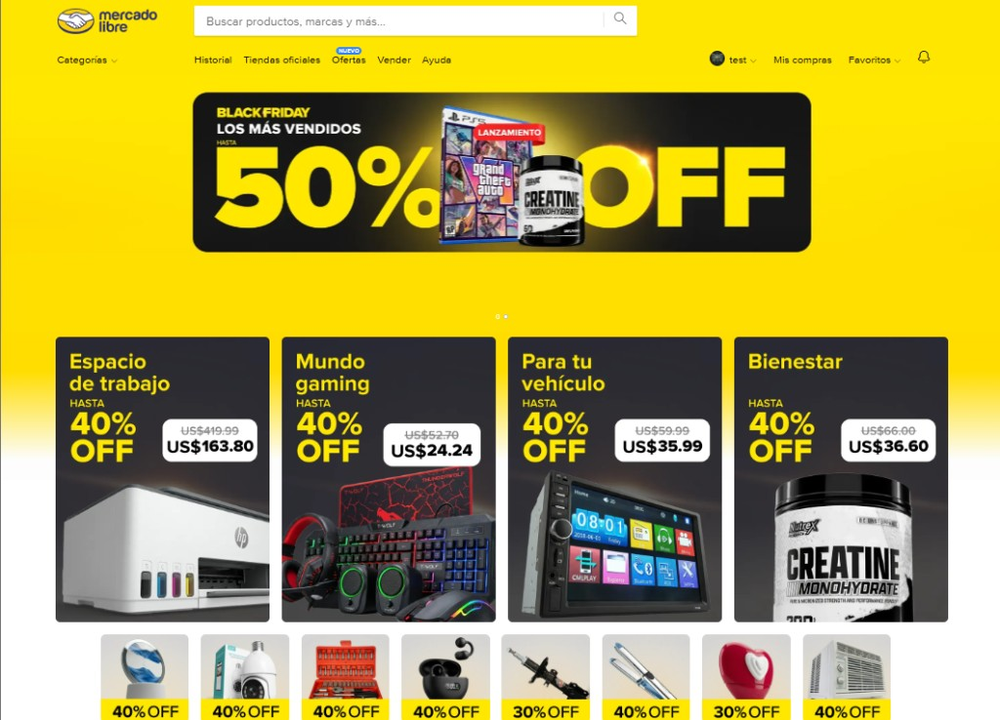 | 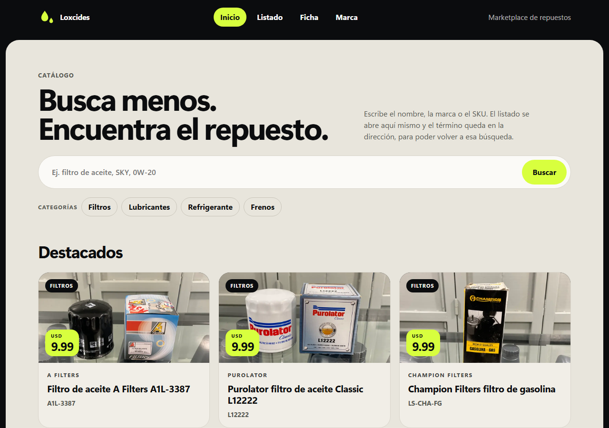 | 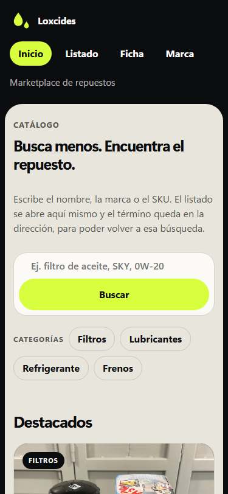 |

### Listado

| Mercado Libre | Locxides · 1280 px | Locxides · 375 px |
| --- | --- | --- |
| 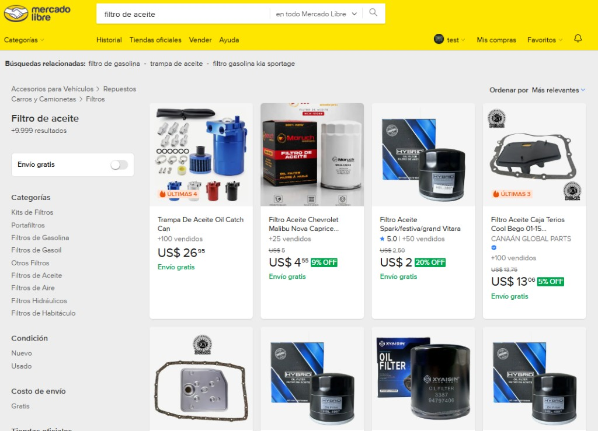 | 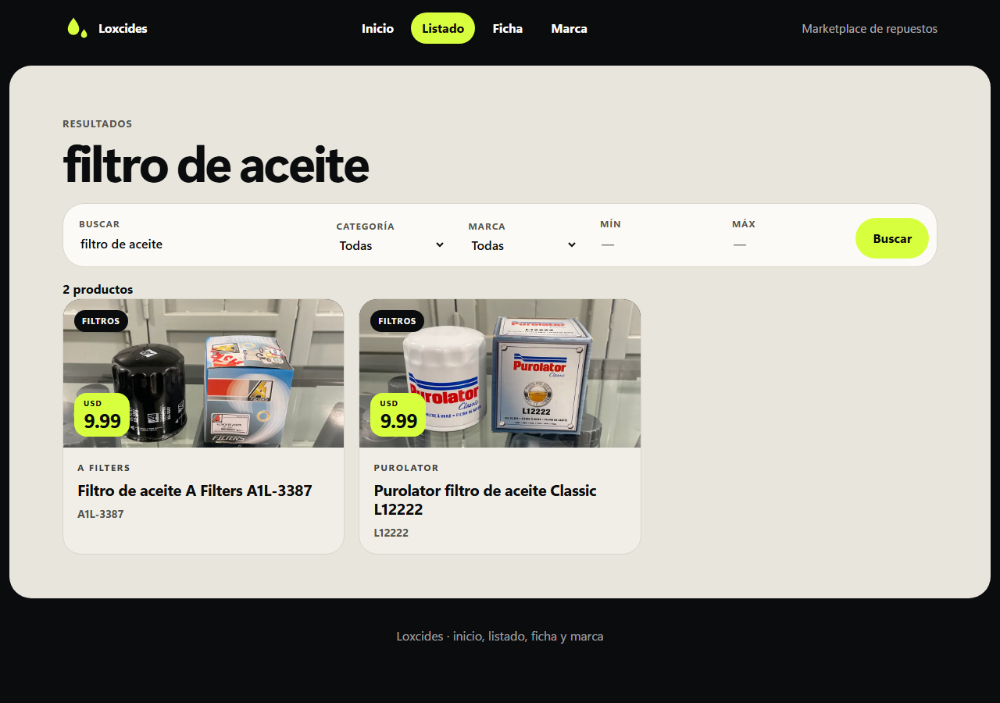 | 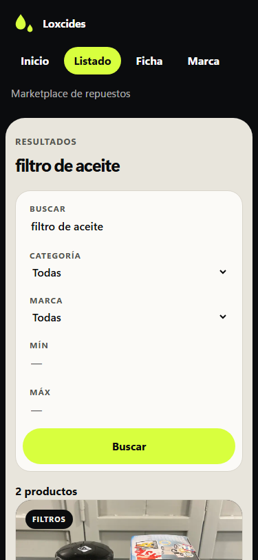 |

### Ficha

| Mercado Libre | Locxides · 1280 px | Locxides · 375 px |
| --- | --- | --- |
| 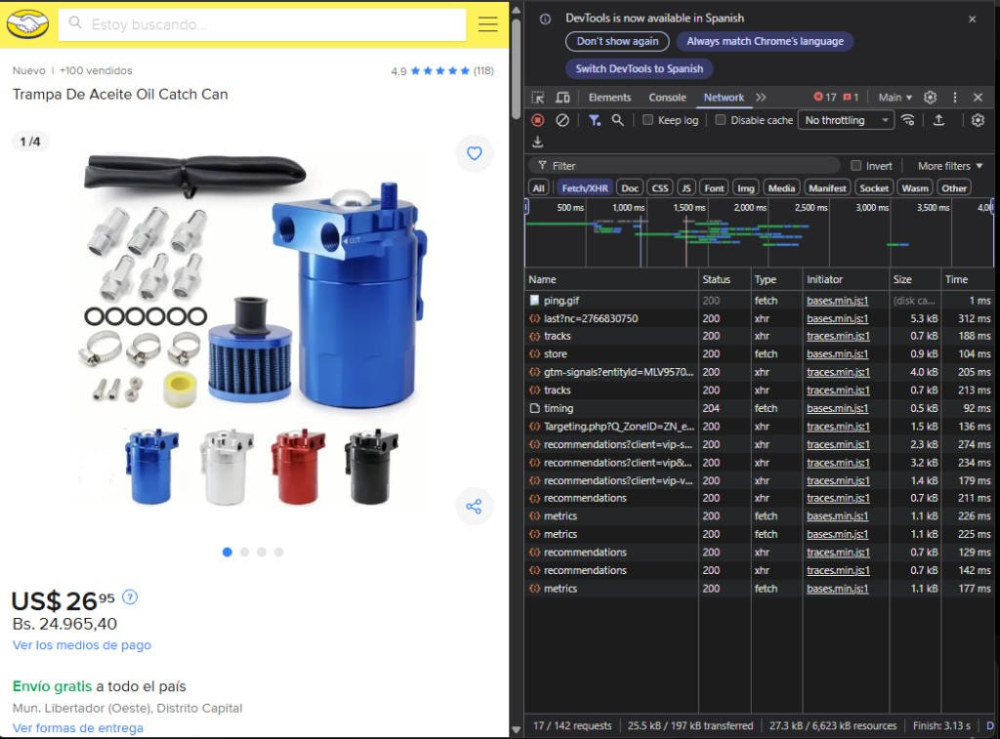 | 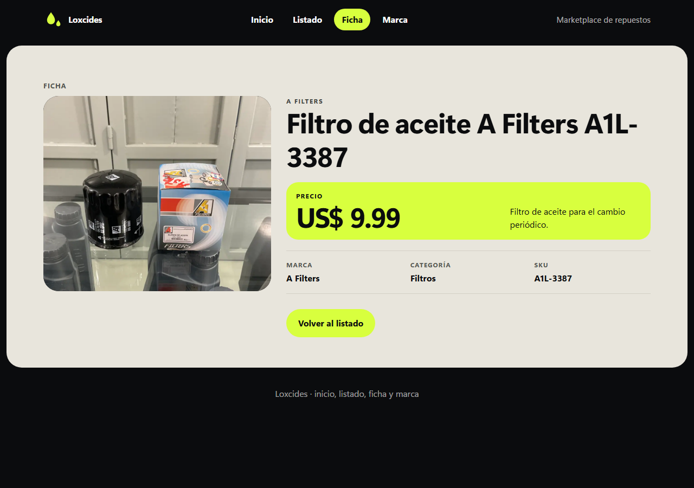 | 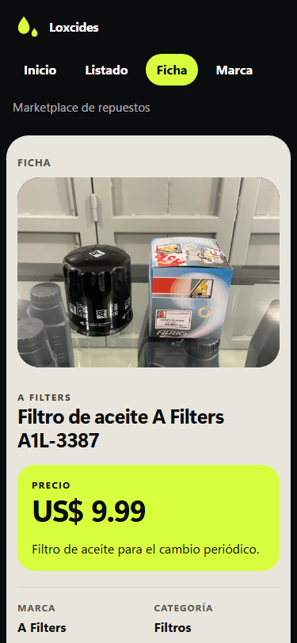 |

### Lighthouse (H1.3)

Escritorio, 27 nov 2026. Original: rendimiento 86, accesibilidad 96, buenas prácticas 73.
Locxides: 98, 100 y 100. El detalle está en `docs/ingenieria-inversa.md`.

| Original | Locxides |
| --- | --- |
| 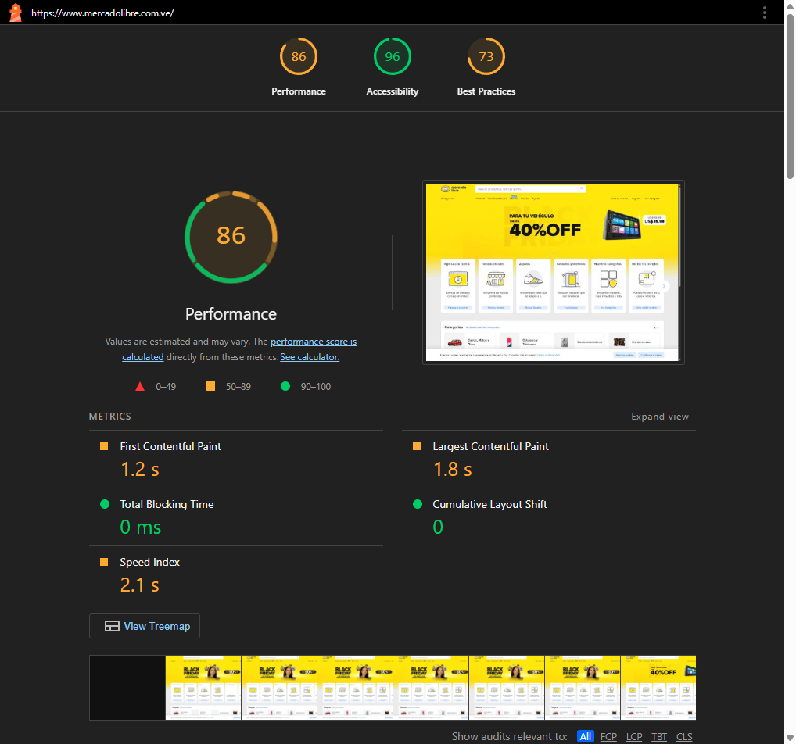 | 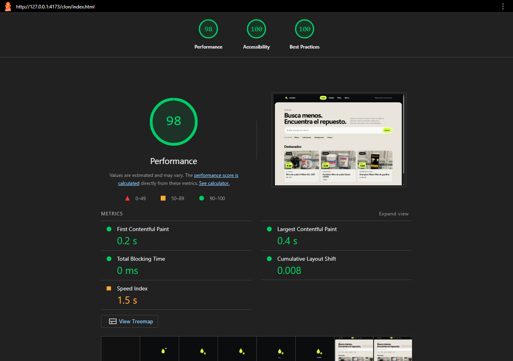 |
