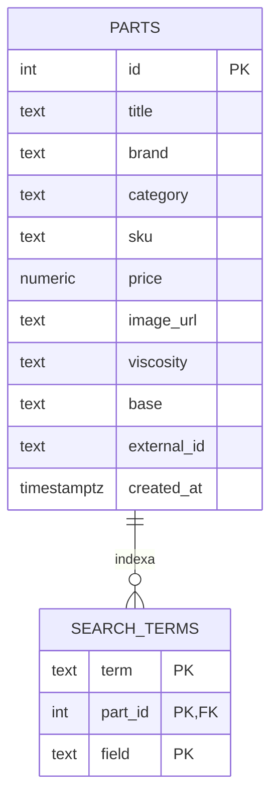

# PRD · Locxides

> Documento de requisitos del producto (Product Requirements Document).
> Historia H0.3. La aprobación del profesor se pide en un Issue.
> Cada requisito funcional (RF) se convierte en un Issue con la plantilla "Historia de usuario".

| Campo | Valor |
| --- | --- |
| Alumno | Sebastian Arteaga · CI 28.307.667 |
| Proyecto n.º | 3 · Marketplace de repuestos |
| Sitio de referencia | [Mercado Libre Venezuela](https://www.mercadolibre.com.ve/) |
| Compañero revisor | Pendiente |
| URL desplegada | (se completa en el Sprint 5) |
| Marca propia | Locxides. En la documentación de este proyecto el nombre es Locxides. La app oficial (`src/app/web`) se llama Loxcides. La experiencia se inspira en Mercado Libre; el nombre, el logo y los colores no. |

## 1. Problema

Quien busca un repuesto (filtro, aceite, refrigerante, freno) suele recorrer un catálogo grande
con el nombre a medias: sabe la marca, la viscosidad o un pedazo del SKU, y necesita cruzar eso
con un precio. Un `LIKE '%texto%'` sobre toda la tabla se pone lento cuando el catálogo crece
a miles de filas, y un listado sin filtros obliga a leer resultados que no sirven.

Locxides es un marketplace de repuestos para esa búsqueda: texto libre y, a la vez, marca,
categoría y rango de precio.

## 2. Usuarios

- **Usuario principal:** quien compra o cotiza repuestos. Entra desde el teléfono (375 px) o el
  computador (1280 px), escribe un término y afina con marca, categoría y precio.
- **Usuario secundario:** quien mantiene el catálogo. Da de alta, edita y retira repuestos para
  que la búsqueda no muestre fichas viejas.

## 3. Objetivo y métrica de éxito

Un usuario encuentra un repuesto por texto y filtros combinados en una sola consulta, y el
listado sigue respondiendo con 10.000 registros sin congelar el navegador.

## 4. Alcance del MVP

Entre 5 y 8 funcionalidades que SÍ entran este semestre.

1. Catálogo de repuestos con ficha (título, marca, categoría, SKU, precio, foto).
2. Alta, edición y baja de un repuesto.
3. Búsqueda por texto libre con índice invertido.
4. Filtros combinados: marca, categoría y rango de precio, con o sin texto.
5. Orden por relevancia (el SKU pesa más que el título, y el título más que la categoría).
6. Pantallas de inicio, listado y ficha, usables a 375 px y a 1280 px.

### Funcionalidades → carpetas de `src/` (screaming architecture)

Cada funcionalidad del alcance será una carpeta en `src/`. Nómbralas en inglés y en plural.

| Funcionalidad | Carpeta |
| --- | --- |
| Catálogo de repuestos | `src/parts` |
| Búsqueda y filtros | `src/search` |

`src/tasks` es la funcionalidad de ejemplo de la plantilla. No es del producto: se retira cuando
el catálogo la reemplace del todo.

## 5. Fuera de alcance

Lo que NO vas a construir.

- Inicio de sesión, registro, roles y pagos. No se recrean esas pantallas del sitio real.
- Carrito, checkout, envíos, reputación del vendedor y publicidad.
- Copiar la marca de Mercado Libre (nombre, logo amarillo, tipografía Proxima Nova).
- Publicar en el repositorio los valores de las cookies de una sesión real.

## 6. Requisitos funcionales

| ID | Requisito | Prioridad (alta, media, baja) |
| --- | --- | --- |
| RF-01 | Listar repuestos con título, marca, categoría, SKU, precio y foto. | alta |
| RF-02 | Crear, editar y eliminar un repuesto. La entrada se valida con Zod y el precio no puede ser negativo. | alta |
| RF-03 | Buscar por texto libre. La consulta se parte en tokens y se resuelve con el índice invertido (`search_terms`), no con `LIKE '%…%'`. | alta |
| RF-04 | Filtrar por marca, categoría y precio mínimo/máximo. El mínimo no puede ser mayor que el máximo. | alta |
| RF-05 | Combinar texto y filtros en una sola consulta: primero los candidatos del índice, después los filtros. | alta |
| RF-06 | Si no hay texto, listar solo con los filtros. | alta |
| RF-07 | Ordenar los resultados por relevancia: SKU 5, título 3, marca 3, etiqueta 2, categoría 1. | media |
| RF-08 | Abrir la ficha de un repuesto desde el listado, sin pantalla de pago ni de acceso. | alta |
| RF-09 | Conservar el término de búsqueda en la URL para poder volver a esa consulta. | media |

## 7. Requisitos no funcionales

- Responsive, móvil primero (375 px y 1280 px).
- Lighthouse ≥ 90 en Accesibilidad y Buenas prácticas.
- 0 errores en la consola del navegador.
- Funciona con 10.000 registros sin congelarse.
- SQL escrito a mano, parametrizado (`$1`, `$2`), en el repositorio de cada funcionalidad.
- Cada cambio de tablas es una migración nueva en `db/migrations/`. No se edita una migración ya aplicada.
- TypeScript en modo `strict`, sin `any`.

## 8. Modelo de datos

Dos tablas propias del producto. `parts` es el catálogo. `search_terms` es el índice invertido:
una fila por término, repuesto y campo donde apareció. `tasks` es la tabla de ejemplo de la
plantilla y no forma parte de este modelo.

Las categorías válidas quedaron en la migración `003`: Lubricantes, Filtros, Refrigerante,
Frenos, Aditivos, Motor, Encendido, Eléctrico, Herramientas. Los campos `viscosity`, `base` y
`external_id` se agregaron en esa misma migración para alinear la ficha con el catálogo de aceites.

| Tabla | Columna | Tipo | Restricción |
| --- | --- | --- | --- |
| `parts` | `id` | `integer` | PK, identidad |
| `parts` | `title` | `text` | NOT NULL, 1 a 200 caracteres |
| `parts` | `brand` | `text` | NOT NULL, 1 a 80 caracteres |
| `parts` | `category` | `text` | NOT NULL, solo las 9 categorías de la migración 003 |
| `parts` | `sku` | `text` | NOT NULL, default `''` |
| `parts` | `price` | `numeric(12,2)` | puede ser NULL |
| `parts` | `image_url` | `text` | NOT NULL, default `''` |
| `parts` | `viscosity` | `text` | NOT NULL, default `''` |
| `parts` | `base` | `text` | NOT NULL, default `''` |
| `parts` | `external_id` | `text` | único cuando no es NULL |
| `parts` | `created_at` | `timestamptz` | NOT NULL, default `now()` |
| `search_terms` | `term` | `text` | PK (junto con `part_id` y `field`) |
| `search_terms` | `part_id` | `integer` | PK, FK a `parts(id)` ON DELETE CASCADE |
| `search_terms` | `field` | `text` | PK, solo `title`, `brand`, `category`, `sku`, `tag` |

Índices: `search_terms(term)`, `parts(brand)`, `parts(category)`, `parts(price)`.

## 9. Reto técnico distintivo

Índice invertido para búsqueda, más filtros combinados (marca, categoría, precio). El diseño
está en [docs/adr/0003-inverted-index-search.md](adr/0003-inverted-index-search.md) y el
enunciado en [docs/reto.md](reto.md).

La consulta con texto se resuelve así: normalizar y partir `q` en tokens, leer la lista de
`part_id` de cada token en `search_terms`, intersectar esas listas (AND) y recién ahí aplicar
marca, categoría y rango de precio. Sin texto, se listan `parts` solo con los filtros SQL.
El código de normalizar, tokenizar e intersectar lo escribe el estudiante en
`src/shared/algorithms/`. Hasta que eso esté conectado, la API de búsqueda responde
`notImplemented` cuando `q` trae texto.

## 10. Riesgos y preguntas abiertas

- El índice todavía no está cableado: con texto, la búsqueda no devuelve resultados reales.
- `src/tasks` y la tabla `tasks` siguen en el proyecto. Hay que retirarlas sin borrar la migración `001`.
- Falta el nombre del compañero revisor.
- La aprobación de este PRD depende de un Issue que el profesor debe aceptar.
