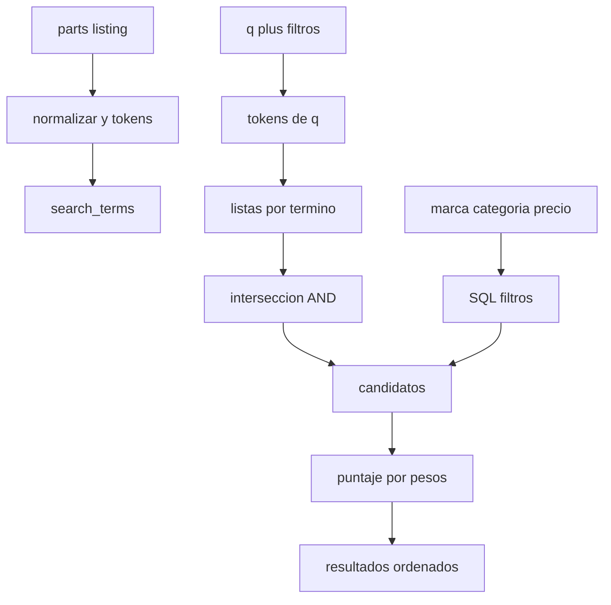

# ADR 0003 · Índice invertido + filtros combinados

- **Estado:** aceptada
- **Reto:** H9.1 · catálogo proyecto 3

## Contexto

El marketplace de repuestos necesita búsqueda por texto libre y filtros a la vez. Un lab de
referencia (Aceite · `laboratorio/busqueda`) resolvió esto con SQLite, tabla `termino` e
intersección de posting lists. Este curso exige **PostgreSQL**, **Express**, **Vite** y
screaming architecture: se adopta el *diseño*, no el stack Astro/SQLite.

## Decisión

1. **Stack:** se mantiene Vite + Express + `pg`. No se porta Astro ni el lab como servidor aparte.
2. **Catálogo** en tabla `parts` y **índice invertido** en tabla `search_terms`.
3. **Funcionalidades:** `src/parts/` (CRUD) y `src/search/` (consulta + vista).
4. **Algoritmos** (normalizar, tokenizar, construir índice, intersección): el estudiante los
   escribe a mano en `src/shared/algorithms/`. La IA no entrega esa implementación.
5. Migración `002_parts_and_search.sql`. No editar `001_init.sql`. `tasks` se retira después.

### Flujo de consulta



### Esquema SQL definitivo

```sql
CREATE TABLE parts (
  id          integer       GENERATED ALWAYS AS IDENTITY PRIMARY KEY,
  title       text          NOT NULL CHECK (char_length(title) BETWEEN 1 AND 200),
  brand       text          NOT NULL CHECK (char_length(brand) BETWEEN 1 AND 80),
  category    text          NOT NULL CHECK (category IN (
                  'brakes', 'filters', 'engine', 'electrical',
                  'suspension', 'body', 'other'
                )),
  sku         text          NOT NULL DEFAULT '',
  price       numeric(12, 2),
  image_url   text          NOT NULL DEFAULT '',
  created_at  timestamptz   NOT NULL DEFAULT now()
);

CREATE TABLE search_terms (
  term        text          NOT NULL,
  part_id     integer       NOT NULL REFERENCES parts(id) ON DELETE CASCADE,
  field       text          NOT NULL CHECK (field IN (
                  'title', 'brand', 'category', 'sku', 'tag'
                )),
  PRIMARY KEY (term, part_id, field)
);

CREATE INDEX idx_search_terms_term ON search_terms (term);
CREATE INDEX idx_parts_brand ON parts (brand);
CREATE INDEX idx_parts_category ON parts (category);
CREATE INDEX idx_parts_price ON parts (price);
```

### Pesos de ranking

| Campo | Peso |
| --- | --- |
| `sku` | 5 |
| `title` | 3 |
| `brand` | 3 |
| `tag` | 2 |
| `category` | 1 |

Consulta sin texto (`q` vacío): listar `parts` solo con filtros SQL.
Con tokens: intersección de posting lists (a mano) + filtros + puntaje.

### Dónde vive en `src/`

```text
src/parts/     catálogo
src/search/    endpoint + vista de búsqueda
src/shared/algorithms/   normalizar / índice / intersección (a mano)
src/tasks/     ejemplo plantilla · se retira más adelante
src/app/web/   Vite (se queda)
```

## Alternativas consideradas

| Alternativa | A favor | En contra |
| --- | --- | --- |
| Traer Astro + lab SQLite de Aceite | Ya funciona en otro proyecto | Rompe plantilla, CI, Docker y evaluación del curso |
| Solo `LIKE` / `tsvector` de PostgreSQL | Menos código propio | No demuestra el reto de índice invertido a mano |
| **Índice propio en `search_terms` (elegida)** | Defensible en viva; alineado al catálogo | Hay que mantener el índice al crear/editar parts |

## Consecuencias

- Cada alta/edición de un repuesto debe actualizar `search_terms` (sync del índice, a cargo del alumno).
- Mientras el índice en algorithms no exista, `/api/search` con `q` no vacío responde sin resultados y marca `notImplemented`.
- `docs/reto.md` describe el problema; “cómo lo resolví” se completa al implementar.
